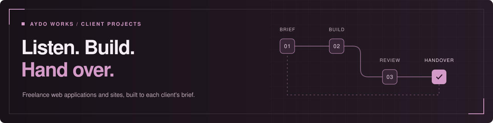
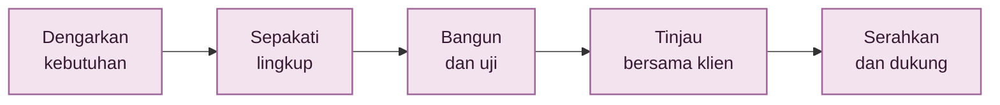

# AYDO Works

**Aplikasi web dan situs yang dikerjakan sesuai kebutuhan klien.**

AYDO Works menyimpan proyek freelance dan pesanan klien, terpisah dari proyek pribadi di **[AYDO Projects](https://github.com/AYDO-Projects)**. Pemisahan ini menjaga kepemilikan kode tetap jelas: setiap repository di sini dibuat untuk klien tertentu dan diserahkan kepada mereka.

[Pendekatan](#pendekatan) · [Alur kerja](#alur-kerja) · [Penamaan](#penamaan) · [Prinsip](#prinsip)

## Pendekatan

Setiap pesanan memiliki repository sendiri dan bersifat private. Lingkungan pengembangan memakai template Docker dari **[AYDO Tools](https://github.com/AYDO-Tools)**, sama seperti proyek pribadi, sehingga proyek lama dapat dijalankan kembali saat klien meminta revisi.

## Alur kerja

Proyek yang sudah diserahkan di-archive. Revisi kecil dikerjakan dengan membuka archive sementara, lalu di-archive kembali.

## Penamaan

Repository aktif memakai prefix stack yang sama dengan AYDO Projects.

| Prefix | Stack |
| :--- | :--- |
| `lfm_` | Laravel dengan Filament |
| `lrv_` | Laravel tanpa Filament |
| `wcms_` | Winter CMS |
| `web_` | Situs statis atau non-Laravel |

Proyek lama yang sudah diserahkan tetap memakai nama aslinya.

## Prinsip

- **Kode milik klien.** Repository bersifat private dan tidak dipublikasikan tanpa izin klien.
- **Lingkup yang disepakati.** Pekerjaan dimulai dari kebutuhan yang jelas dan disetujui bersama.
- **Dapat dilanjutkan.** Setiap proyek dapat dijalankan kembali dari repository dan template Docker yang sama.
- **Serah terima yang rapi.** Kode, data contoh, dan cara menjalankan proyek terdokumentasi saat diserahkan.

---

AYDO Works · Listen. Build. Hand over.
